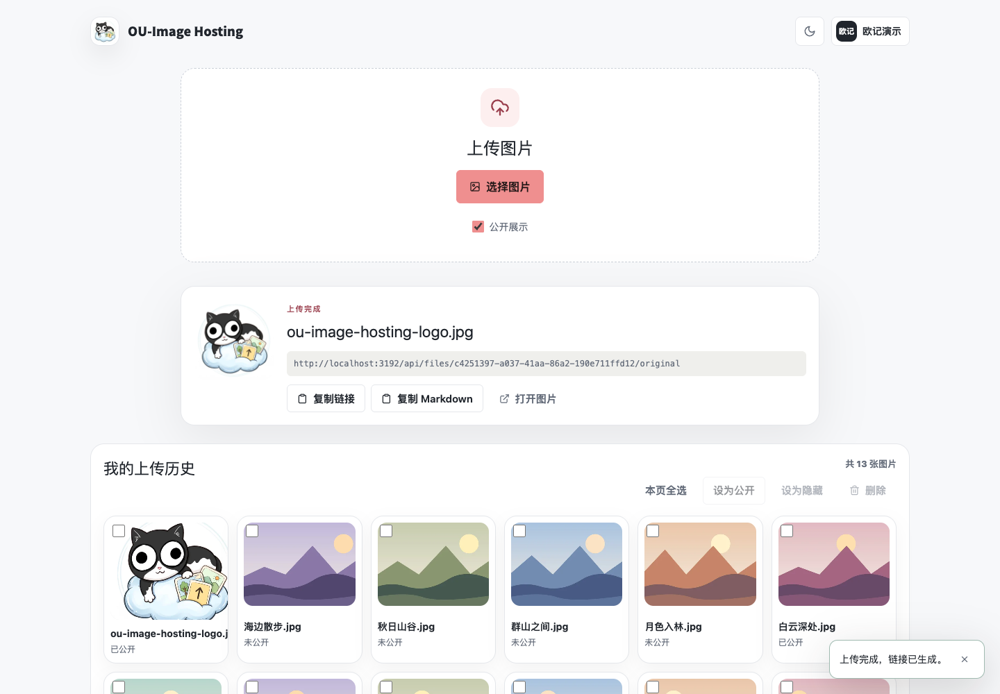
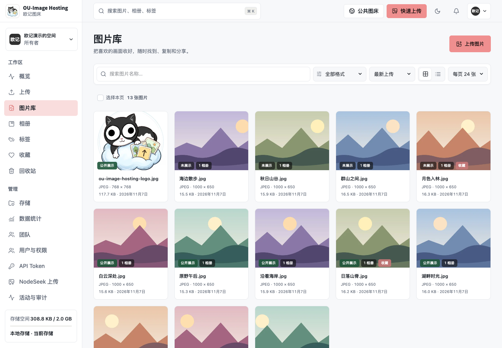
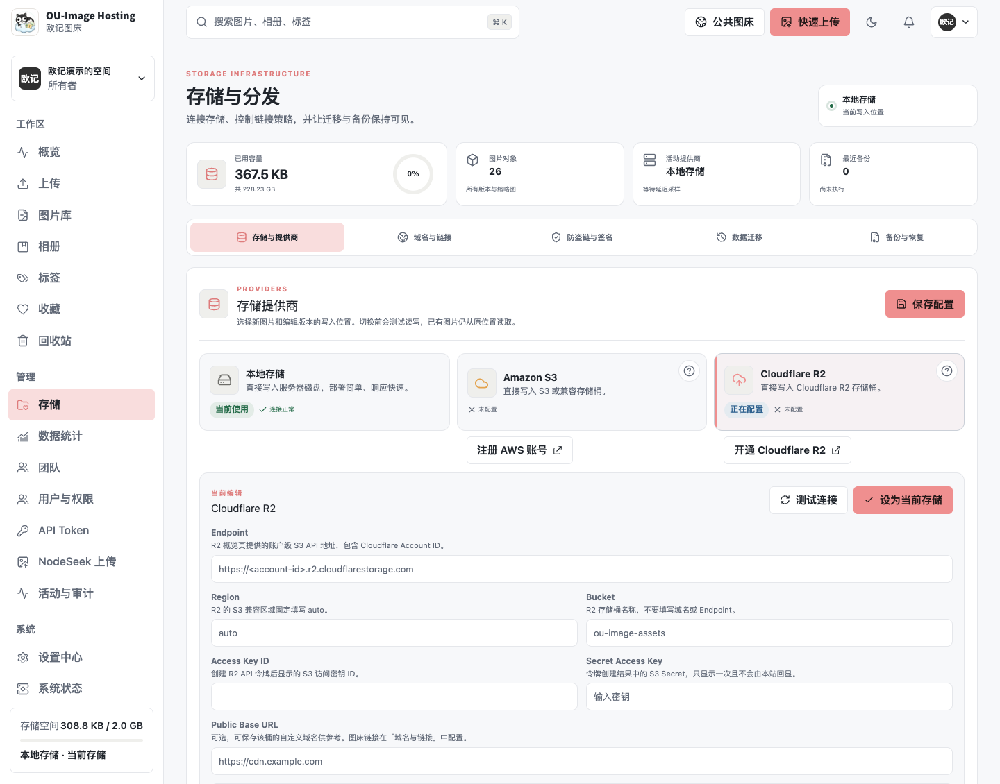
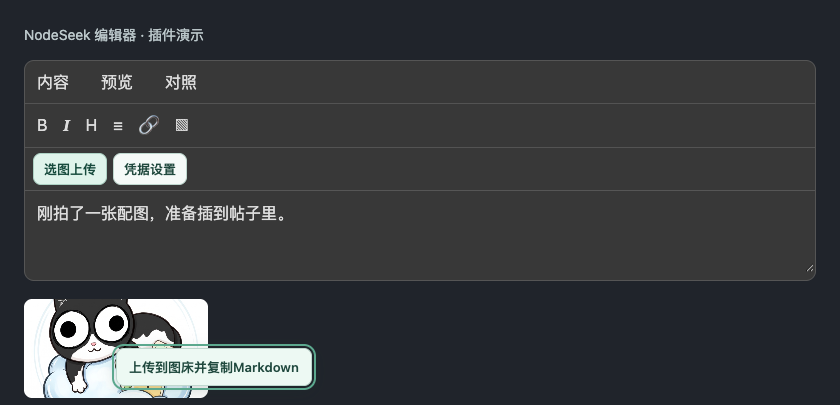

<p align="center">
  
</p>

<h1 align="center">OU-Image Hosting · 欧记图床</h1>

<p align="center">给发帖、写博客和做教程的人用的自托管图床。</p>

<p align="center">
  <a href="https://github.com/cshaizhihao/ou-image-hosting/releases/tag/v2.0.1"></a>
  <a href="https://github.com/cshaizhihao/ou-image-hosting/actions/workflows/check.yml"></a>
  <a href="./LICENSE"></a>
</p>

<p align="center">
  <a href="#快速安装">快速安装</a> · <a href="#功能与截图">功能与截图</a> · <a href="#nodeseek-发图">NodeSeek 发图</a> · <a href="#升级与维护">升级与维护</a> · <a href="https://img.zze.cc/">在线预览</a>
</p>

## 快速安装

在 Linux 服务器上运行安装器。跟随提示选择访问地址和部署方式，再打开安装器给出的地址创建管理员。

```bash
curl -fsSL https://raw.githubusercontent.com/cshaizhihao/ou-image-hosting/main/install.sh | bash
```

安装器会配置 Docker Compose 和所选的反向代理。已在用反向代理的服务器可参考部署文档。使用 Cloudflare Tunnel 时，可参考隔离部署方案。 [部署指南](./docs/deployment.md) · [Cloudflare Tunnel](./docs/tunnel-deployment.md)

## 功能与截图

### 上传图片

首页打开就是上传区，支持选择文件、拖放和粘贴。上传后可复制外链或 Markdown，登录用户可以在同一页查看自己的上传记录。后台还支持批量上传、URL 导入、HEIC / HEIF 和带视频片段的 Live Photo。



### 整理图片

图片库支持搜索、筛选、相册、标签、收藏和批量操作。分享时可以复制 URL、Markdown、HTML 或 BBCode。公共图库可单独开启，公共上传可限制为登录后使用，也可设置速率、每日额度和人机验证。



### 切换存储

本地存储、Amazon S3 和 Cloudflare R2 可以设为当前写入位置。切换前会验证连接和读写权限。新图片写入当前存储，已有图片继续从原位置读取，原链接可继续使用。需要复制本地图片到对象存储时，可以在「数据迁移」里单独发起任务。



## NodeSeek 发图

在自己部署的图床后台打开「NodeSeek 上传」，创建分组并签发专用上传凭据，然后从自己的站点安装脚本。在论坛编辑器里打开「凭据设置」并粘贴凭据即可使用。

- **在编辑器里发图。** 按 Ctrl / ⌘ + V 粘贴截图，或点击「选图上传」。上传后会在草稿中插入 Markdown。
- **保存帖子里的图。** 按 Shift + 右键打开「上传到图床并复制Markdown」。Firefox 可用 Alt + 右键。普通右键保留浏览器菜单。
- **按用途分组。** 上传凭据只允许写入绑定的分组，管理员可撤销凭据。关闭分组的公开展示会将其图片从公共图库隐藏，持有直链的人仍可访问。



## 升级与维护

已有安装先备份，再在服务器上执行升级。使用远端存储时，保留原有对象存储配置、桶访问凭据和 `OU_SECRET_KEY`。 [升级指南](./docs/upgrading.md) · [备份与恢复](./docs/backup-restore.md)

```bash
ouih backup
ouih update
ouih status
```

| 命令 | 用途 |
| --- | --- |
| `ouih` | 打开交互菜单 |
| `ouih logs` | 查看运行日志 |
| `ouih doctor` | 检查端口、DNS、HTTPS、磁盘和运行环境 |
| `ouih restore` | 从备份恢复 |
| `ouih rollback` | 回退最近一次成功更新 |

项目基于 Next.js、React、Fastify、Sharp 和 Docker Compose，采用 MIT 许可。欢迎通过 Issue 反馈使用体验，也欢迎提交 PR。 [V2.0.1 发布说明](./docs/releases/v2.0.1.md) · [安全模型](./docs/threat-model.md) · [故障排查](./docs/troubleshooting.md)
